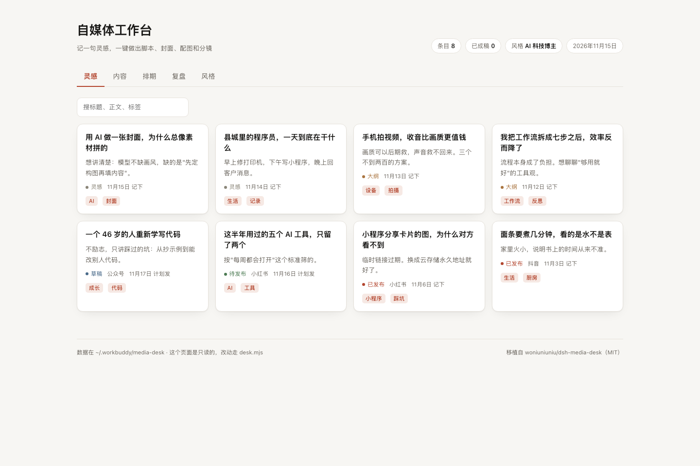
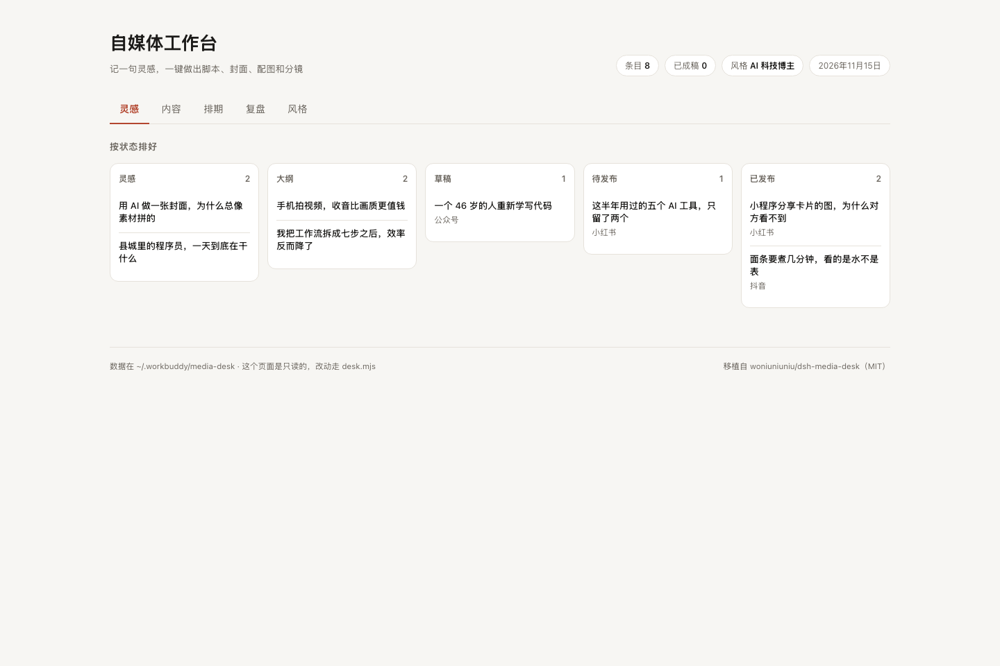
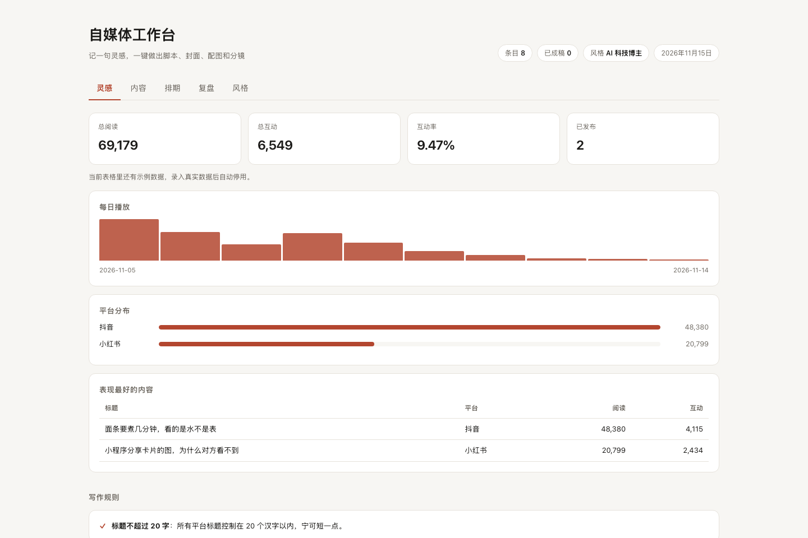

# 自媒体工作台 · Media Desk

一句话记灵感，直接出能发的口播脚本、封面大字和分镜，排好发布时间，再把平台数据读成你自己的写作规则。

这是 [woniuniuniu/dsh-media-desk](https://github.com/woniuniuniu/dsh-media-desk) 的 **WorkBuddy 移植版**，打成了可直接分发的专家包（Expert Package），技能随包内置，拷到别人机器上就能用。

**[在线介绍页](https://phs-bitqun.github.io/media-desk-expert/)** · **[English](README.en.md)** · **[安装说明](INSTALL.md)**



## 它能干什么

- **一句话成稿**：丢半句想法，出策划案 → 口播脚本 / 文章 → 分镜，中途不反问。
- **点名改稿**：「第 3 镜换俯拍」「封面字更有冲击力」只改那一处，不推翻重写。
- **15 个风格卡**：AI 科技、数码测评、美食探店、读书笔记、商业拆解……也能从自己的稿子里提炼一张。
- **排期 + 复盘**：日历排期，录播放 / 点赞 / 评论 / 转发 / 收藏，出互动率、平台分布、日趋势。
- **规则自我强化**：从数据里提炼规律，确认后变成规则，之后每次成稿自动生效。





> 截图用的是内置示例数据，第一次打开是干净的空工作台。

## 安装

需要 **Node.js 18+** 和 WorkBuddy。

```bash
git clone https://github.com/phs-bitqun/media-desk-expert.git
mkdir -p ~/.workbuddy/plugins/marketplaces/my-experts/plugins
cp -R media-desk-expert/media-desk-expert ~/.workbuddy/plugins/marketplaces/my-experts/plugins/
```

重启 WorkBuddy，左侧「专家」里会出现「自媒体工作台」，点进去就能用。

详细步骤、常见问题、数据迁移见 **[安装说明](INSTALL.md)**。

## 用起来是这样

```
记个灵感：用 AI 做封面总像素材拼的
把这条做成口播脚本，走 AI 科技博主那个风格
第 3 镜换成俯拍，封面字更有冲击力
把这周数据录一下，看看有什么规律能沉淀成规则
```

## 数据在哪

`~/.workbuddy/media-desk/state.json`，纯本地文件，不上传、没有账号系统。

- 换电脑想带走历史：整个 `~/.workbuddy/media-desk/` 拷过去。
- 想换位置：设环境变量 `WORKBUDDY_MEDIA_DESK_HOME`。
- 别手改 `state.json`，所有改动走 CLI，否则撤销链会断。

## 仓库结构

```
media-desk-expert/            # 专家包本体，整个目录拷进 my-experts/plugins/
├── .codebuddy-plugin/plugin.json
├── agents/media-desk-expert.md
├── avatars/expert.png
├── skills/media-desk/        # 技能随包内置，不依赖外部安装
│   ├── SKILL.md
│   ├── scripts/desk.mjs      # 状态唯一写入口
│   └── references/
└── README.md
docs/                         # 截图
```

## 命令行核验

不用打开 WorkBuddy 也能确认它是否装好：

```bash
DESK="$HOME/.workbuddy/plugins/marketplaces/my-experts/plugins/media-desk-expert/skills/media-desk/scripts/desk.mjs"
node "$DESK" doctor
```

打印出数据目录和风格数量，就说明通了。

## 致谢与许可

- 原始项目：[woniuniuniu/dsh-media-desk](https://github.com/woniuniuniu/dsh-media-desk)，MIT。
- 移植做了三件事：把宿主/客户端双半片换成一个 CLI + 一个只读看板；把生图换成 WorkBuddy 内置能力；把存储搬到 `~/.workbuddy/`。
- 15 个风格预设、策划案/正文/改稿/风格提炼提示词、复盘→规则的算法均沿用上游。
- 本项目同样以 [MIT](LICENSE) 发布。
